<!--
Projeto open source do GitHub: https://github.com/brunoalex55/busca-vagas

Autor: Bruno Alexandre

Pix (doacao): bruno@brunoalexandre.com

Este projeto e open source. Doe se quiser manter o projeto vivo.

Mais informacoes no README.
-->

# BuscaVagas PRO

> ## Projeto open source
>
> **Este projeto e open source.** O codigo esta no GitHub sob a licenca
> **MIT**: use no seu servidor, altere, traduza, estenda e redistribua
> como quiser. Nao tem dependencia paga, nao pede licenca e nao trava
> nenhuma funcao.
>
> O repositorio: <https://github.com/brunoalex55/busca-vagas>
>
> Se o projeto te ajuda e voce quiser manter ele vivo, a donation em
> **Pix** e sempre bem-vinda (veja ["Apoie este projeto"](#apoie-este-projeto)
> no fim deste README). A donation e **voluntaria** e nao compra nenhuma
> licenca especial nem garantia de suporte.

## ⚠️ Aviso de seguranca: PHP corrigido (CVE-2026-109618 e CVE-2026-109619)

Em 21 de outubro de 2026 o PHP publicou dois avisos de **execucao remota
de codigo (RCE) sem autenticacao**. Os dois afetam todas as instalacoes
que atendem requisicoes da web, com risco maximo justamente no Apache
com mod_php, que e o caso do servidor deste projeto.

| Vulnerabilidade | Caminho do ataque |
|---|---|
| **CVE-2026-109618** (GHSA-w8hw-w9fx-j79w) | O tratamento de memoria esgotada interrompe o PHP com os dados internos da requisicao pela metade. A limpeza passa a tratar dado invalido como valido, o que corrompe a memoria e permite executar codigo **antes de qualquer linha da aplicacao rodar**. |
| **CVE-2026-109619** (GHSA-6wmf-4rv5-p3rp) | O estado interno de uma requisicao sobrevive depois da memoria ser liberada. Como o mod_php atende varias requisicoes no mesmo processo, a requisicao seguinte reaproveita esse estado velho. O caminho confirmado passa pelo `session.upload_progress.enabled`. |

### O que foi feito aqui

**A atualizacao do PHP, que e a solucao completa:**

| Ambiente | Antes | Depois |
|---|---|---|
| Servidor de producao | 8.3.6 | **8.3.36** (confirmado no CLI e no mod_php do Apache) |
| Ambiente local (Windows) | 8.4.26 | **8.4.27** |

**As medidas de contencao, aplicadas enquanto a atualizacao nao chegava:**

| Medida | Onde | Para que serve |
|---|---|---|
| `session.upload_progress.enabled = 0` | `conf.d` do apache2, cli e fpm | Fecha o caminho confirmado do CVE-2026-109619 |
| `php_admin_value memory_limit -1` | `conf-available/seguranca-php.conf` | Tira o limite finito de memoria (CVE-2026-109618). Por ser `php_admin_value`, a aplicacao nao consegue recolocar um limite |
| `post_max_size = 32M` e `upload_max_filesize = 16M` | Apache | Limita o corpo da requisicao, mantendo o envio de imagens do painel |
| `LimitRequestBody`, `LimitRequestFields` e `LimitRequestLine` | Apache (`conf-available/limites-requisicao.conf`) | Limites de requisicao no servidor web, como o aviso recomenda |
| `MemoryMax=1G` e `MemoryHigh=768M` | systemd + cgroup | Com o `memory_limit` sem limite, o servidor nao pode ser esgotado |
| `minPhpVersion = '8.2.35'` (com a conferencia por serie) | `public/index.php` e `spark` | O sistema recusa rodar em um PHP vulneravel |
| Restricao de versao no `composer.json` | `composer.json` | O `composer install` tambem bloqueia versao vulneravel |

> O aviso oficial e claro: *"only an update is a complete solution"*. As
> contencoes acima reduzem a exposicao, mas **nao substituem** a
> atualizacao.

### A versao minima por serie

O aviso do PHP e para as series 8.2, 8.3, 8.4 e 8.5, e cada uma tem a
sua versao corrigida. O sistema confere a serie em que esta rodando:

| Serie | Versao corrigida |
|---|---|
| 8.2 | 8.2.35 |
| 8.3 | 8.3.36 |
| 8.4 | 8.4.27 |
| 8.5 | 8.5.12 |

### O que rotacionar depois de uma exposicao

O aviso vale para qualquer instalacao que ficou exposta no periodo
entre a publicacao e a atualizacao. O que precisa ser trocado:

- a senha do banco de dados e a do usuario do sistema;
- o **token global do cron** (`writable/cron_token.txt`), que autentica
  as chamadas do agendador externo;
- a chave de criptografia do sistema (`CRIPTOGRAFIA_CHAVE` no `.env`),
  que invalida as senhas de app guardadas;
- as sessoes do painel (a pasta `writable/session/`), forcando o login
  de novo.

---
> SaaS de busca de empregos: encontra vagas no Google Jobs, monta a
> candidatura com o curriculo em PDF e envia o e-mail **pela conta Gmail de
> cada usuario**, dentro de uma janela de envios controlada.

Construido em **CodeIgniter 4**, **PHP 8.4**, **MySQL 8 / MariaDB 10.4+**,
com **HTML5 semantico + CSS3 puro** e **JavaScript vanilla** (ES6+).
Sem Bootstrap, Tailwind, jQuery, React, Node.js ou qualquer outro
framework: o front-end e o back-end usam apenas o que ja vem no PHP.

---

## A dor real

Quem procura emprego gasta horas por semana fazendo sempre a mesma coisa:
procurar a vaga, ler o anuncio, descobrir o e-mail de contato, escrever
uma mensagem curta, anexar o curriculo e enviar. Dez vagas dao uma hora.
Cinquenta comem a tarde inteira — e toda semana comeca de novo.

Fazer isso na mao tambem queima a conta do Gmail: mandar vinte mensagens
parecidas em seguida e exatamente o que os filtros de spam foram feitos
para pegar. O candidato ve as candidaturas sumirem sem saber por que, e
a conta pode ser bloqueada de vez.

Tem ainda o problema do controle: depois de quarenta candidaturas fica
impossivel lembrar o que ja foi enviado, para qual empresa, o que
respondeu e qual vaga ja tinha sido candidatada.

**O BuscaVagas PRO existe para tirar essa parte repetitiva da frente.**
O usuario diz o que procura (termo + cidade), o sistema encontra as
vagas, extrai o e-mail de contato, manda o curriculo com uma mensagem
curta — pela conta Gmail do proprio usuario, num ritmo que nao parece
spam — e mostra exatamente o que foi enviado, para quem e se a empresa
confirmou o recebimento.

## O que este projeto resolve

- **Busca que roda sozinha** — palavras-chave e cidades configuradas uma
  vez; o sistema procura no horario agendado (ou sob demanda) e traz as
  vagas para o painel.
- **Candidatura enviada pelo e-mail do proprio usuario** — cada um usa a
  sua conta Gmail com a sua APP PASSWORD. Nao existe e-mail global: uma
  conta bloqueada nao afeta ninguem mais.
- **Envio que nao parece spam** — janela de horario permitida, dias da
  semana, intervalo entre os envios e limite diario por plano.
- **O curriculo nunca sai da conta** — o PDF fica na pasta do usuario e
  vai anexado sozinho.
- **Duas fontes de vaga, um painel** — Google Jobs (SerpApi) e Divulga
  Vagas (bot com navegador de verdade), atras da mesma interface de
  adaptador: um terceiro provedor entra sem mexer no resto do sistema.
- **Prova de que deu certo** — o site confirma o envio e o sistema guarda
  essa confirmacao, vaga por vaga.
- **Planos que fazem sentido** — cada plano define palavras-chave,
  cidades por termo, envios por dia e quantas contas cabem; os limites
  sao sempre conferidos no servidor.
- **Privacidade entre os usuarios** — a vaga pertence a conta que a
  encontrou: ninguem ve (nem candidata) o que nao e dele.
- **Administracao que mostra o dinheiro** — relatorio mensal de quantos
  usuarios o sistema teve, receita estimada e bloqueio das contas que
  pararam de pagar.

## Por que open source

Este projeto nasceu de um problema pessoal. Cada funcionalidade foi
implementada conforme a necessidade aparecia: primeiro a busca, depois a
candidatura, depois o bot do segundo site, depois os planos porque o uso
crescia e os limites passaram a importar.

Nao existe agencia grande por tras dele nem verba para trafego pago. Por
isso decidi abrir o codigo: para medir a aceitacao, para ajudar quem tem
o mesmo problema e, a partir da visibilidade que isso gera, conseguir
trabalho de consultoria.

Se ele te ajuda, usa. Se quiser apoiar o projeto, o Pix no fim deste
README e voluntario.

---

## 1. Sobre o projeto

O sistema automatiza a parte repetitiva da candidatura: o usuario cadastra
palavras-chave (termo + cidades), o sistema procura as vagas, extrai o
e-mail de contato do anuncio e envia a candidatura com o curriculo em PDF.

Pontos que definem o projeto:

- **Cada usuario usa a propria conta Gmail** (com a propria APP PASSWORD).
  Nao existe e-mail global, nem envio compartilhado: uma conta bloqueada
  afeta apenas quem a usa.
- **As janelas de envio sao suaves**: intervalo entre envios, horario
  permitido e dias da semana, para nao parecer spam nem queimar a conta.
- **O usuario comum nunca ve nada sobre a SerpApi**: chaves, cotas e
  provedores sao coisa do administrador.
- **O agendamento e por linha de comando** (`php spark ...`), com tres
  modos de execucao escolhidos pelo admin.

---

## 2. Requisitos

| Item | Versao / Observacao |
|---|---|
| PHP | **8.2.35** ou superior na serie 8.2; **8.3.36**, **8.4.27** ou **8.5.12** nas demais (veja o [aviso de seguranca](#-aviso-de-seguranca-php-corrigido-cve-2026-109618-e-cve-2026-109619)) |
| MySQL | 8.0 ou superior (tambem funciona com MariaDB 10.4+) |
| Composer | 2.x (apenas para as dependencias do framework) |
| Extensoes do PHP | `intl`, `mbstring`, `json`, `mysqlnd`, `curl`, `openssl` |

Para verificar as extensoes: `php spark phpini:check`.

---

## 3. Instalacao

```bash
# 1. Dependencias
composer install

# 2. Configuracao
cp .env.example .env        # no Windows: copy .env.example .env
php spark key:generate      # gera a encryption.key

# 3. Banco de dados
#    ajuste database.* no .env e crie o schema:
php spark db:create
php spark migrate           # cria as tabelas
php spark db:seed           # admin padrao + configuracao do site

# 4. Servidor de desenvolvimento
php spark serve
```

O `.env` guarda o que e **da maquina**: banco, URL base, e-mail do
sistema e (opcionalmente) o caminho do PHP de linha de comando
(`cron.caminhoPhpCli`).

> No Windows, o projeto traz `php.cmd`, `composer.cmd`, `serve.cmd`,
> `db-start.cmd` e `db-stop.cmd` para funcionar sem instalar nada no
> sistema.

---

## 4. Login inicial do admin

O `db:seed` cria o administrador padrao:

- **E-mail:** `admin@admin.com`
- **Senha:** `admin123`

**Troque a senha no primeiro acesso** (Admin > Minha conta). A senha fica
gravada com `password_hash(PASSWORD_BCRYPT)`, nunca em texto.

---

## 5. Como gerar a APP PASSWORD do Gmail (por usuario)

Cada usuario gera a **propria** APP PASSWORD da **propria** conta
Gmail:

1. No Google Account, ative a **verificacao em duas etapas**.
2. Em **Seguranca > Senhas de app**, crie uma senha de app chamada
   "BuscaVagas" (16 letras, sem espacos).
3. Copie a senha gerada (ela **so aparece uma vez**).
4. No painel, em **Configuracoes**, cole a APP PASSWORD no campo
   "APP PASSWORD (Google)" e salve.

O sistema guarda a senha **cifrada** (AES-256-CBC) e **nunca** a exibe
depois de salva. Sem APP PASSWORD cadastrada, o envio automatico fica
bloqueado e o painel avisa o motivo.

---

## 6. Como funciona o limite de envios

As protecoes contra bloqueio de conta ficam em **Configuracoes** (por
usuario) e sao aplicadas pelo `EnviadorEmails`:

| Parametro | Padrao | Efeito |
|---|---|---|
| `limite_envios_dia` | 20 | Maximo de e-mails por dia |
| `intervalo_minimo_segundos` | 180 | Intervalo minimo entre dois envios |
| `intervalo_maximo_segundos` | 420 | Intervalo maximo (o envio e espalhado dentro da faixa) |
| `horario_inicio_envio` | 08:00:00 | Inicio da janela permitida |
| `horario_fim_envio` | 20:00:00 | Fim da janela permitida |
| `dias_semana_permitidos` | 1,2,3,4,5 | Segunda a sexta |

Alem disso, o sistema respeita o **tempo desde o ultimo envio** gravado
em `data_ultimo_envio`: se ainda nao passou o intervalo sorteado, a
execucao para com o motivo `aguardando_intervalo` e retoma depois.

---

## 7. APP PASSWORD por usuario (nunca global)

A APP PASSWORD vive em `configuracoes` (uma linha por usuario), cifrada
pela chave do sistema (`encryption.key` no `.env`). Consequencias:

- o admin **nao** enxerga a senha de ninguem (nem a propria, depois de
  salva);
- trocar a APP PASSWORD de um usuario **nao** afeta os outros;
- o sistema **nao** envia e-mail por uma conta global: cada envio usa a
  conta do proprio usuario.

---

## 8. Como cadastrar e aprovar usuarios

1. O visitante se cadastra em `/registro`.
2. O pedido fica em `solicitacoes_liberacao` com status `pendente` (e o
   usuario fica `pendente`, sem acesso ao painel).
3. O administrador **aprova** em **Admin > Solicitacoes** (ou libera a
   conta pela listagem de usuarios).
4. Aprovado, o usuario entra com o e-mail e a senha cadastrados, completa
   as configuracoes (e-mail remetente, APP PASSWORD, curriculo) e pode
   ativar o envio automatico.

---

## 9. Como cadastrar multiplas chaves SerpApi

Em **Admin > Chaves**:

1. **Nova chave**: informe o apelido e a chave da SerpApi (obtida em
   serpapi.com/dashboard).
2. Cada chave tem **quantidade mensal de consultas** (o saldo) e uma
   **ordem** de uso: as chaves com ordem menor rodam primeiro.
3. O botao "**Zerar contador**" devolve o saldo usado (util no inicio de
   cada mes).
4. O botao "**Marcar invalida**" desliga a chave quando a credencial e
   recusada; o sistema entao passa para a proxima chave automaticamente.
5. O sistema **reinicia o ciclo mensal** sozinho: quando o mes vira, as
   chaves voltam ao saldo e as que foram invalidadas por credencial
   sao religadas.

Em **Admin > Distribuicao** voce ve a cota de cada usuario e pode
**recalcular** a divisao.

---

## 10. Como o sistema distribui as consultas automaticamente

O `DistribuicaoConsultas` divide o **saldo disponivel** (soma do que
sobra nas chaves) entre os usuarios:

1. Usuarios com **limite manual** (definido pelo admin) recebem a cota
   cheia primeiro e sao preservados.
2. O restante do saldo e dividido entre os usuarios automaticos, com
   peso igual ao **numero de combinacoes** (cidades) de cada um.
3. Cada cota tem um **piso** (as combinacoes do usuario) e um **teto**
   (3x a media). Se o saldo acabar, as cotas sao reduzidas a partir do
   piso, sem nunca passar de zero.
4. A divisao e recalculada a cada execucao e pode ser forcada pelo
   botao "Recalcular".

---

## 11. Como adicionar um novo provedor de vagas (adaptador)

Todo o sistema conversa com o provedor pela interface
`App\Contracts\JobsProviderInterface` (metodos `buscar()` e `nome()`).
Para plugar outro provedor:

1. Crie `app/Libraries/Provedores/MeuProvedor.php` implementando a
   interface (e, se quiser, `App\Interfaces\...` helpers proprios).
2. Registre a instancia em `app/Config/Services.php`, no metodo
   `provedorVagas()`, escolhendo conforme `Config\ProvedorVagas::$servico`.
3. Ajuste `app/Config/ProvedorVagas.php` (URL base, tempo limite,
   tentativas, motor, pais, idioma, sufixo de "remoto").
4. No `.env`: `provedorVagas.servico = meu_provedor`.

Nenhum outro arquivo precisa mudar: o orquestrador (`BuscadorVagas`), os
models e o painel desconhecem o provedor concreto.

---

## 12. Como configurar a chave PIX (texto)

Em **Admin > Configuracao do site > Pagamento**:

- **Chave PIX**: o texto que voce copia do seu banco ou provedor (aparece
  na tela de "aguardando liberacao" do usuario);
- **Valor mensal**: o preco da assinatura (ex.: `29.90`);
- o texto digitado pelo usuario no formulario vira um
  `solicitacoes_liberacao` com status `pendente`, que o admin aprova
  ou rejeita.

---

## 13. Calculo de frequencia com multiplas cidades

Uma palavra-chave com o termo "Analista" e as cidades "Ponta Grossa",
"Curitiba" e "Sao Paulo" vale **3 combinacoes** (uma por cidade). O
sistema:

- conta as combinacoes ativas do usuario (soma das cidades de cada
  palavra-chave);
- usa esse numero como **peso** na divisao das consultas;
- ao agendar a proxima execucao, dilui o intervalo da frequencia pedida
  ao longo das combinacoes, para nao estourar a cota de uma vez.

Palavras-chave com "trabalho remoto" somam a busca **remota** a consulta
por cidade (o sufixo "remoto" entra no proprio texto da busca, porque o
Google Jobs nao tem filtro dedicado).

---

## 14. Consulta manual

O administrador pode disparar as tarefas na hora, em **/admin/cron**
(menu "Agendamento"):

- **Executar vagas**: roda a busca de vagas para todos os usuarios
  ativos.
- **Executar e-mails**: roda o envio de e-mails para todos os usuarios
  ativos.

Os dois botoes sao POST e pedem confirmacao antes de rodar. O resultado
aparece na tela e fica registrado em
`writable/logs/cron-externo-YYYY-MM-DD.log` (a saida dos comandos vai
para `cron-externo-saida-YYYY-MM-DD.log`).

---

## 15. Envio automatico (CRON 2)

Com o envio automatico ligado, o usuario entra na fila de candidatos.
O `EnviadorEmails` (CRON 2) escolhe a vaga da fila, verifica as regras
de janela, intervalo e limite diario, e chama o `EnviadorEmail`, que
monta a mensagem (assunto e corpo com as variaveis `{titulo_vaga}`,
`{empresa}`, `{localizacao}`, `{fonte}`, `{url_vaga}`, `{seu_nome}`),
anexa o curriculo em PDF e envia pela conta Gmail do usuario,
respeitando:

- a janela de horario e os dias permitidos;
- o intervalo sorteado entre os envios;
- o limite diario de envios.

Cada envio fica registrado em `emails_enviados` (com `origem`,
`status` e `mensagem_erro`).

---

## 16. Extracao de e-mail em 2 etapas

O `ExtratorEmail` procura o e-mail de contato em duas etapas:

1. **Na descricao do anuncio**: o texto e varrido em busca de enderecos
   (o que vem primeiro tem prioridade).
2. **Nos links do anuncio**: depois, o sistema olha os links de
   candidatura (`apply_options` e equivalentes) e extrai os enderecos
   encontrados ali.

As duas listas sao unidas sem repetir, sempre em minusculas. Se nenhum
endereco aparecer, a vaga fica **sem e-mail** e nao entra no envio.

---

## 17. Lista completa de prefixos na blacklist

Para nao considerar e-mails que nao sao de contato real, sao ignorados:

**Prefixos locais:** `noreply`, `no-reply`, `naoresponda`, `nao-responda`,
`nao_responda`, `donotreply`, `do-not-reply`, `mailer-daemon`,
`mailerdaemon`, `postmaster`, `abuse`, `webmaster`.

**Dominios ignorados:** `serpapi.com`, `google.com`, `google.com.br`,
`googlemail.com.br`, `example.com`, `example.com.br`, `exemplo.com`,
`exemplo.com.br`, `dominio.com`, `dominio.com.br`, `seudominio.com`,
`test.com`, `teste.com`, `localhost`, `sentry.io`,
`sentry-next.wixpress.com`, `wixpress.com`, `schema.org`, `w3.org`,
`gravatar.com`, `cloudflare.com`, `jquery.com`, `bootstrapcdn.com`,
`fontawesome.com`.

**Extensoes que nao sao e-mail:** `png`, `jpg`, `jpeg`, `gif`, `svg`,
`webp`, `bmp`, `ico`, `css`, `js`, `json`, `woff`, `woff2`, `ttf`, `eot`,
`mp4`, `webm`, `pdf`, `zip`, `rar`.

---

## 18. Como funciona a priorizacao de e-mails

As vagas da fila sao ordenadas por **relevancia da fonte** (numero menor
= mais relevante):

1. Indeed
2. LinkedIn
3. Catho
4. Gupy
5. demais fontes

Dentro da mesma fonte, a ordem continua pela data de publicacao e pela
ordem de insercao (as mais antigas primeiro, para nao repetir sempre as
mesmas).

---

## 19. Como funciona a deduplicacao de vagas

A deduplicacao acontece em **dois niveis**, sempre por usuario:

1. **`job_id`**: o identificador do anuncio na origem (quando o provedor
   informa). E o identificador forte.
2. **Hash do conteudo**: quando o provedor nao devolve `job_id`, o
   sistema calcula um hash do **titulo + empresa + localizacao**. O mesmo
   anuncio, encontrado por caminhos diferentes, cai no mesmo hash.

Assim a mesma vaga nao entra duas vezes na fila, mesmo vinda de fontes
diferentes.

---

## 20. Como evitar reenvio de e-mail (ja_candidatado)

Ao enviar, o sistema marca a vaga com `ja_candidatado = 1`. A fila de
envio **so considera vagas com `ja_candidatado = 0`**, entao a mesma vaga
nao recebe uma segunda candidatura. O usuario tambem pode marcar a vaga
pelo botao "Marcar candidatada" (na listagem `/painel/vagas` e no
detalhe da vaga).

---

## 21. Como funciona o SEO do site publico

- **Meta tags**: `title`, `description`, `keywords`, `author`, `robots` e
  `canonical`, com os dados de `configuracao_site`.
- **Open Graph e Twitter Card**: tipo, imagem, titulo, descricao e URL.
- **JSON-LD (schema.org)**: `Organization`, `WebSite` e `Product` (com as
  ofertas dos planos), montados no layout.
- **`/sitemap.xml`**: gerado pelo controller `Sitemap` a partir das
  paginas publicas.
- **`/robots.txt`**: gerado pelo controller `Robots` (permite indexar o
  site, bloqueia `/painel` e `/admin`).
- As paginas internas do painel sao `noindex` por layout.

---

## 22. Como configurar o site publico (configuracao_site)

Em **Admin > Configuracao do site**: nome, slogan, descricao, palavras-chave
de SEO, e-mail, telefone, WhatsApp, endereco, logo, favicon e imagem de
compartilhamento. O rodape e o cabecalho leem esses dados; a semeadura ja
cria os valores padrao.

---

## 23. Execucao de tarefas agendadas (Bloco A)

O sistema suporta **tres modos de agendamento**. O administrador escolhe
o modo em **/admin/cron** (menu "Agendamento"):

| Modo | Quem dispara | Documentacao |
|---|---|---|
| `cron_linux` | crontab do Linux, via `scripts/cron-linux.sh` | [docs/agendamento-linux.md](docs/agendamento-linux.md) |
| `cron_windows` | Agendador de Tarefas do Windows, via `scripts/cron-windows.bat` | [docs/agendamento-windows.md](docs/agendamento-windows.md) |
| `spark_manual` | disparo pelo painel ou por servico externo (cron-job.org) | [docs/agendamento-manual.md](docs/agendamento-manual.md) |

Pontos importantes:

- **Os tres modos usam os mesmos Spark Commands**:
  `php spark vagas:consultar` (CRON 1) e
  `php spark emails:enviar-automaticos` (CRON 2).
- **O modo escolhido nao altera o codigo dos comandos**: ele apenas
  define *quem* chama o comando. As regras (cota, limites por execucao,
  pausa entre consultas, intervalo de envio) sao sempre as mesmas.
- **Teste sempre manualmente antes de agendar**: os scripts aceitam
  `--simular`, que mostra o comando final sem executar nada.
- **Token externo por usuario**: o job do servico externo leva o token
  individual no header `X-Cron-Token`; o admin pode regenera-lo a
  qualquer momento (o antigo deixa de valer).

---

## 24. Integracao com o cron-job.org (Bloco D)

- **O que e**: um servico externo que faz requisicoes HTTP periodicas
  para uma URL. resolve o caso de quem nao tem crontab.
- **Como o sistema integra**: pela API REST, o painel cria **dois jobs por
  usuario ativo** (vagas a cada 10 min, e-mails a cada 5 min), cada um
  chamando o endpoint externo com o token do usuario.
- **API base**: `https://api.cron-job.org` (autenticacao
  `Authorization: Bearer`).
- **Como obter a chave de API**: no cron-job.org, em Settings > API.
  Cole em `/admin/cron` > "Chave de API do cron-job.org" e salve.
- **Botao "Sincronizar Jobs"**: cria ou atualiza os jobs de todos os
  usuarios ativos, respeitando o teto de requisicoes por dia.
- **Tutorial completo**: [docs/tutorial-cron-job-org.md](docs/tutorial-cron-job-org.md)
  (o mesmo passo a passo aparece como bloco expansivel dentro do painel).
- **Seguranca**: o token vai no header `X-Cron-Token`, nunca na URL; a
  chave de API e unica da conta do SaaS e nao e compartilhada; se um
  token vazar, gere outro e atualize o job.
- **Limites do plano gratuito**: 50 jobs por conta, 100 requisicoes de
  API por dia, criacao limitada a 1 por segundo e 5 por minuto e timeout
  de 30 segundos por requisicao.

---

## 25. Execucao manual pelo usuario (Bloco E)

- O usuario pode executar **manualmente a busca de vagas e o envio de
  e-mails** pelo cartao "Execucoes manuais" em `/painel`, pelos botoes
  "**Executar busca de vagas agora**" e "**Executar envio de e-mails
  agora**".
- **Limite configuravel pelo admin** (padrao de **3 por dia**), definido
  em `/admin/usuarios` (ficha do usuario) ou em `/admin/cron`. O valor
  **0 desabilita** as execucoes manuais.
- **O limite vale para o total** (vagas e e-mails somados).
- **O contador reseta todo dia** (a contagem e por data).
- **O admin pode zerar o contador** de um usuario a qualquer momento.
- **O admin executa sem limite** (a isencao vale para o painel
  administrativo).
- **As execucoes do usuario registram em `logs_consulta` com
  `origem = 'manual_usuario'`**, e na tabela `execucoes_manuais_usuario`.

---

## 26. IMPORTANTE: o usuario comum nao ve nada sobre a SerpApi

Chaves, cotas, saldos, provedores e a distribuicao de consultas sao
visiveis **apenas no painel administrativo**. O usuario comum ve somente
os seus proprios dados: palavras-chave, vagas, candidaturas, historico e as
suas configuracoes de envio.

---

## 27. IMPORTANTE: cada usuario usa o proprio APP PASSWORD

O envio sempre sai pela conta Gmail do proprio usuario, com a APP
PASSWORD cifrada no banco. Se a conta de um usuario for bloqueada pelo
Google, o problema afeta **apenas ele** - e o painel mostra o erro
(`erro_credencial`) na fila de envio.

---

## 28. IMPORTANTE: sem CSRF, apenas sessao nativa

O sistema **nao usa token CSRF** (nao existe `csrf_field()` no projeto).
A protecao vem da sessao nativa do CodeIgniter 4: cookies com
`HttpOnly`, `SameSite` e regeneracao de id no login e na troca de senha.
Toda escrita passa por POST.

---

## 29. O segundo provedor: Divulga Vagas (painel do usuario)

O segundo provedor usa um bot (Python + Playwright) que trabalha no
site do Divulga Vagas. O usuario comum tem telas proprias para isso:

- **/painel/divulgavagas** (item "Divulga Vagas" no menu do painel):
  - **Buscar vagas agora**: roda a busca de UMA combinacao (termo +
    cidade) escolhida pelo usuario. E o mesmo caminho do CRON 1.
  - **Candidatar-se agora**: o bot se candidata pelo site em ate 3
    vagas pendentes. E o mesmo caminho do CRON 2.
  - A tela mostra a situacao das candidaturas (aguardando o bot,
    aguardando o e-mail, enviada pelo site, enviada com e-mail, com
    erro e bloqueio do Cloudflare) e as barras de limite do dia.
- **/painel/vagas**: a aba "Divulga Vagas" filtra as vagas do segundo
  provedor, cada uma com o selo da situacao da candidatura.
- **/painel/vagas/{id}**: o botao "Candidatar agora" faz a candidatura
  de UMA vaga especifica.
- **/painel/divulgavagas/historico**: as ultimas execucoes (so leitura).

E o **administrador** tem telas proprias:

- **/admin/divulgavagas** (item "Divulga Vagas" no menu do admin): dispara
  a busca e a candidatura com o **alvo** escolhido (todos os usuarios
  ativos ou um usuario especifico), mostra a situacao das candidaturas de
  todo o sistema e grava os **limites globais** de execucao manual do
  dia (zero desliga a execucao manual).
- **/admin/divulgavagas/historico**: as ultimas execucoes do sistema.
- **/admin/cron**: a secao "Divulga Vagas" mostra os dois agendadores
  (CRON 1 e CRON 2) e as URLs para o agendador externo.
- **/admin/logs**: o filtro **por provedor** (SerpApi ou Divulga Vagas)
  nas abas de consultas e de envios.

As regras que valem nessas telas:

- a execucao manual **nunca** contorna limite nenhum (vale o limite do
  bot, o limite de e-mail e o limite de execucoes manuais do dia);
- quando a vaga tem e-mail de contacto, a candidatura e pelo site **e**
  o e-mail tambem e enviado (o "duplo envio");
- toda escrita e POST e toda execucao fica registrada na tabela
  `execucoes_divulgavagas`.

---

## 30. O segundo provedor por dentro (bot, Chrome e limites)

### 30.1 Como o bot funciona

O segundo provedor nao usa API: ele trabalha no site do Divulga Vagas
com um navegador de verdade.

- `automacoes-rpa/` guarda os bots (um pacote por provedor);
- o `chrome_service.py` lanca o Chrome como um processo separado, com
  perfil proprio em `writable/automacoes-rpa/chrome/sessions` e o
  controle na porta 9222 (CDP);
- o `bot.py` se conecta no Chrome por CDP, usa **uma aba por chamada** e
  fecha so essa aba (nunca fecha o navegador inteiro);
- o servico do Chrome **nunca encerra o Chrome do usuario**: ele so
  para o processo que ele mesmo lancou (o PID fica no arquivo
  `writable/automacoes-rpa/chrome/chrome_service.pid`).

Para subir o servico do Chrome:

```powershell
.\automacoes-rpa\chrome_service.ps1 start     # Windows
```

```bash
bash automacoes-rpa/chrome_service.sh start   # Linux
```

### 30.2 O que o bot precisa

- o Python com Playwright (o caminho fica no `.env`):

```
divulgavagas.python = "C:/caminho/do/python.exe"
```

- o Chrome instalado no sistema (o servico usa o Chrome do proprio
  sistema, com um perfil separado do usuario).

### 30.3 Cloudflare

O site do Divulga Vagas usa Cloudflare. Em `headless = 1` o desafio
aparece e o bot marca a vaga como `cloudflare`. A solucao aqui e
simples e honesta: o servico do Chrome roda **com janela de verdade**
(`headless = 0` em `automacoes-rpa/config.ini`) e o perfil persistente
guarda o cookie do desafio.

Nao existe nenhum contorno de Cloudflare no codigo: quando o bloqueio
acontece, a vaga fica marcada como bloqueada e o administrador ve o
motivo no selo e no historico.

### 30.3.1 Cada provedor tem o proprio horario de consulta

Cada palavra-chave tem dois horarios: um do SerpApi
(`proxima_execucao`) e um do Divulga Vagas
(`proxima_execucao_divulgavagas`). Isso e importante: quando os dois
provedores usavam o mesmo horario, quem rodasse primeiro empurrava a
palavra para o dia seguinte e o outro provedor nunca mais consultava
aquela palavra (a busca parava com "sem_palavras" e trazia zero vaga,
sem nenhum erro).

A **execucao manual ignora o horario** (quem pede, pede na hora): ela
consulta todas as palavras ativas do usuario. O agendador respeita a
frequencia escolhida pelo usuario.

### 30.4 Os dois agendadores (separados)

| CRON | O que faz | Endpoint |
|---|---|---|
| 1 | busca as vagas no site | `POST /cron/global/divulgavagas/buscar-vagas?token=...` |
| 2 | candidata pelo site (e envia o e-mail quando ha contacto) | `POST /cron/global/divulgavagas/candidatar?token=...` |

Os dois usam o token global do sistema e sao **independentes** do
agendamento do SerpApi. Tambem existem por usuario:

- `POST /cron/usuario/{id}/divulgavagas/buscar-vagas?token=...`
- `POST /cron/usuario/{id}/divulgavagas/candidatar?token=...`

> **Onde fica o token global:** ele e criado sozinho na primeira
> execucao e vive em `writable/cron_token.txt` (fora da raiz web). Esse
> arquivo **nunca e versionado** — o `.gitignore` protege a pasta. Voce
> ve o valor em `/admin/cron` e pode gerar um novo a qualquer momento
> (o botao "Regenerar token global"); depois disso, atualize a URL dos
> jobs no cron-job.org.

E os comandos Spark (o caminho oficial, sem HTTP):

```bash
php spark divulgavagas:buscar-vagas [--usuario=N] [--limite=N]
php spark divulgavagas:candidatar [--usuario=N] [--vaga=ID] [--limite=N]
```

O `--limite` limita quantas vagas a execucao candidata. Sem ele, o
comando **esvazia a fila inteira** (uma vaga de cada vez, com a pausa
entre elas).

**O cuidado com o agendador externo:** o cron-job.org abandona a
requisicao depois de 30 segundos. Por isso a chamada por HTTP
(`/cron/.../divulgavagas/candidatar`) faz **1 vaga por chamada**
(`divulgavagas.maxVagasPorChamada`): a fila vai sendo drenada pelas
chamadas seguintes (e o comando Spark, sem limite de tempo, drena
tudo de uma vez).

### 30.4.1 O cron-job.org agenda TUDO (inclusive o Divulga Vagas)

O painel de agendamento (`/admin/cron`) agenda, pelo cron-job.org, **um
job por usuario e por tipo de tarefa**. Os tipos ficam num unico
registro, em `GerenciadorCron::TIPOS_DE_JOB`:

| Tipo | Comando Spark | Frequencia |
|---|---|---|
| `vagas` | `vagas:consultar` | a cada 10 min |
| `emails` | `emails:enviar-automaticos` | a cada 5 min |
| `divulgavagas_buscar` | `divulgavagas:buscar-vagas` | a cada 30 min |
| `divulgavagas_candidatar` | `divulgavagas:candidatar` | a cada 30 min |

O botao "Sincronizar Jobs" cria (ou atualiza) os quatro jobs de cada
usuario ativo, e o job chama o endpoint externo do sistema
(`POST /cron/usuario/{id}/executar-externo?comando=<tipo>`) com o token
individual do usuario.

**Para incluir um provedor novo no cron-job.org basta uma entrada no
registro** (rotulo, comando Spark, frequencia e se o comando aceita a
opcao `--origem`). O painel, a sincronizacao, o endpoint externo e a
tabela de jobs passam a conhecer o tipo novo sem nenhuma outra mudanca.

### 30.4.2 Execucao manual: em segundo plano

O bot leva dezenas de segundos (a busca) ou minutos (varias
combinacoes). Por isso **nenhuma execucao manual roda dentro do pedido
web**: o painel solta o comando Spark em segundo plano (o mesmo
mecanismo do agendador) e responde na hora com "iniciada em segundo
plano". O resultado aparece no historico (`execucoes_divulgavagas`) e
nos selos das vagas.

### 30.5 Os limites

| Limite | Onde | Padrao |
|---|---|---|
| buscas manuais do usuario por dia | `configuracoes.divulgavagas_max_buscas_manuais_dia` | 3 |
| candidaturas manuais do usuario por dia | `configuracoes.divulgavagas_max_candidaturas_manuais_dia` | 5 |
| candidaturas do bot por dia (por usuario) | `configuracoes.divulgavagas_max_candidaturas_bot_dia` | 30 |
| buscas manuais do admin por dia | `configuracao_global.admin_max_buscas_manuais_dia` | 10 |
| candidaturas manuais do admin por dia | `configuracao_global.admin_max_candidaturas_manuais_dia` | 20 |
| e-mails por dia (mesmo mecanismo do SerpApi) | `configuracoes.limite_envios_dia` | 20 |

Zero desliga a execucao manual daquele tipo. A execucao manual
**nunca** contorna limite nenhum: vale o limite do bot, o limite de
e-mail e o limite de execucoes do dia.

### 30.6 O duplo envio

Quando a vaga tem e-mail de contacto, a candidatura acontece **de
duas formas**: o bot se candidata pelo site **e** o e-mail e enviado
pelo mesmo `EnviadorEmail` do SerpApi (com a APP PASSWORD do
usuario). O status da vaga fica `enviada_email`. Sem e-mail de
contacto, so o bot: o status fica `enviada`.

### 30.6.1 O loop: a fila inteira, sem clicar de novo

A candidatura **nao para em uma vaga**. O comando (e o botao do
painel) roda em loop: uma vaga de cada vez, ate a fila do usuario
acabar (ou ate o limite diario do bot, que e 30 por dia).

- o intervalo entre as candidaturas do mesmo loop e uma pausa curta
  (`divulgavagas.pausaEntreCandidaturas`, 8 segundos), para nao
  martelar o site;
- o limite diario do bot continua valendo: quando ele acaba, a
  execucao para e o proximo ciclo continua de onde parou;
- o mesmo vale para o CRON 2: ele esvazia a fila, uma vaga por vez.

O loop esta no nucleo da candidatura (`CandidaturaDivulgaVagas`),
entao **todo provedor novo que usar esse nucleo ganha o loop de
graca** — e o botao "Candidatar agora" de UMA vaga continua
existindo so como atalho para uma vaga especifica.

### 30.6.2 A prova de que candidatou

O bot so considera a candidatura feita quando chega na pagina de
sucesso do site. A confirmacao e guardada na vaga
(`candidatura_divulgavagas_confirmado_em` e
`candidatura_divulgavagas_confirmacao_url`) e aparece:

- no detalhe da vaga (com o link da pagina de sucesso);
- na lista **"Candidaturas realizadas"** do painel do usuario e do
  admin (a vaga, a empresa, como foi feita e a data da confirmacao);
- no historico das execucoes.

Assim o painel responde a pergunta "foi mesmo?" sem depender de
palavra.

### 30.6.3 O historico mostra vaga por vaga

Cada execucao guarda o **detalhe** do que aconteceu em cada vaga (em
JSON, na coluna `detalhes` da tabela `execucoes_divulgavagas`). O
historico do painel do usuario e do admin mostram essa lista: a vaga, a
empresa, se o e-mail foi enviado e se o site confirmou a candidatura
("Confirmada pelo site").

### 30.7 A tela antiga do admin

A tela `/admin/crons` foi substituida pela tela de agendamento
`/admin/cron`. O endereco antigo **redireciona** para a tela nova (e
as acoes de escrita dele apontam para os equivalentes novos), entao
nenhum link guardado deixa de funcionar.

---

## 31. Estrutura de pastas

```
app/
  Commands/      Comandos Spark (vagas:consultar, emails:enviar-automaticos, divulgavagas:buscar-vagas, divulgavagas:candidatar)
  Config/        Configuracoes (Cron, ProvedorVagas, DivulgaVagas, Email, Curriculo, ...)
  Contracts/     Interfaces (JobsProviderInterface)
  Controllers/   Site (publico), Painel (usuario) e Admin (administrador)
  Database/      Migrations e Seeds
  Filters/       Autenticacao, usuario ativo e acesso admin
  Helpers/       Funcoes de apoio (site, dados, divulgavagas)
  Libraries/     Regras de negocio (BuscadorVagas, EnviadorEmails, GerenciadorCron, ...)
  Models/        Acesso ao banco (Usuario, Vaga, LogConsulta, ...)
  Views/         site, painel, admin, layouts, partials, errors
automacoes-rpa/ Bots de automacao (um pacote por provedor: divulgavagas)
docs/            Documentacao (agendamento, tutorial do cron-job.org, checklist final)
scripts/         cron-linux.sh e cron-windows.bat (prontos para o agendador)
tools/           Ferramentas de conferencia (detector do Bloco C e checklist final)
public/          Raiz web (index.php, assets/)
writable/        Logs, cache, sessoes e o perfil do Chrome do bot (fora do versionamento)
tests/           Testes do framework (unit, database, session)
```

---

## 32. Como rodar os testes

```bash
composer install
vendor/bin/phpunit              # suite do framework (unit, database, session)
```

Os testes de interface estao em `tests/` e seguem o padrao do
CodeIgniter 4 (`*Test.php` com `CIUnitTestCase`).

Ha ainda tres ferramentas de conferencia do proprio projeto:

```bash
# detector do Bloco C: ternario, sintaxe alternativa e eco curto em app/
php tools/detector-c1.php

# checklist final: confere os 217 itens do plano e gera
# docs/checklist-final.md
php tools/checklist/verificar.php

# revisao final: roda os 7 testes do plano de ponta a ponta e gera
# docs/revisao-final.md
php tools/revisao-final.php
```

A Fase 8 (segundo provedor) tem a sua propria suite:

```bash
# os servidores de teste (site local do Divulga Vagas e mock do
# cron-job.org) sobem sozinhos, sem internet
php tools/fase8-site-local.php

# as cinco suites em PHP (modelos, bibliotecas, CRON 1, CRON 2 e provedor)
php tools/fase8-modelos.php
php tools/fase8-bibliotecas.php
php tools/fase8-cron1.php
php tools/fase8-cron2.php
php tools/fase8-provedor.php

# o loop de candidatura (a fila inteira, uma a uma) e a confirmacao
php tools/fase8-loop.php

# as tres suites de tela (precisam do servidor no ar: php spark serve)
powershell -File tools/fase8-painel.ps1
powershell -File tools/fase8-selos.ps1
powershell -File tools/fase8-e2e.ps1

# a suite do painel do admin (telas, filtro por provedor e limites)
powershell -File tools/fase8-admin.ps1

# a integracao com o cron-job.org (jobs por tipo, com o mock da API)
powershell -File tools/fase8-cronjob.ps1

# a Fase 9 (planos por usuario e isolamento de vagas)
php tools/fase9-testes.php
powershell -File tools/fase9-admin.ps1

# a Fase 9 b (pedido de plano, faturamento e bloqueio por pagamento)
php tools/fase9-planos-faturamento.php
powershell -File tools/fase9-modal-faturamento.ps1

# o SQL de sanidade: diz se ha vaga vazada entre usuarios
php tools/fase9-sanidade.php
```

O teste `fase8-e2e.ps1` e o fim a fim: ele cria uma vaga que aponta
para o site local, aperta o botao "Candidatar agora" do painel (por
HTTP) e confere que o bot se candidatou de verdade e que a execucao
ficou registrada.

---

## 33. Planos por usuario

O site publico promete tres planos (em `/precos`, escrito **Precos** com
cedilha no texto exibido). Esses mesmos planos ficam no banco (tabela
`planos`) e o administrador os configura em `/admin/planos`.

| Recurso | Basico | Profissional | Empresa |
|---|---|---|---|
| Palavras-chave | 2 | Ilimitadas | Ilimitadas |
| Cidades por termo | 5 | Ilimitadas | Ilimitadas |
| Envios por dia | 10 | 20 | 50 por usuario |
| Envio automatico | Manual | Ligado | Ligado |
| Envio em massa | - | Sim | Sim |
| Usuarios | 1 | 1 | Ate 5 |
| Suporte | E-mail | E-mail | Prioritario |

**NULL = ilimitado.** Onde o plano nao define um limite (palavras-chave
e cidades por termo nos planos Profissional e Empresa), o valor no banco
e NULL e o sistema trata isso explicitamente (nunca com ternario).

### 34.1 A ordem de prioridade dos limites

Quando o sistema precisa do valor de um limite, ele procura nesta ordem
(a primeira que existir vence):

1. **`usuarios.limite_manual`** - o administrador digitou um valor a mao
   para este usuario (vale sempre e e mostrado como "Limite
   personalizado");
2. **`planos.{campo}`** - o plano do usuario (NULL = ilimitado);
3. **`configuracoes.{campo}`** - o valor legado da conta;
4. **o padrao do sistema**.

A biblioteca que faz isso e a `App\Libraries\ResolvedorPlano`
(`resolverLimite`, `resolverLimiteComOrigem`, `podeAdicionarPalavraChave`,
`podeAdicionarCidade`, `podeEnviarEmailHoje`, `podeUsarEnvioAutomatico`,
`podeUsarEnvioEmMassa`).

### 34.2 O que o administrador faz

- **`/admin/planos`**: cria, edita, desativa e reativa planos (e ve
  quantos usuarios tem em cada um);
- **`/admin/usuarios/{id}`**: atribui o plano, tira o plano (volta para
  o Basico) e grava o limite manual;
- o painel do admin mostra **quantos usuarios ha em cada plano** e
  avisa quando um plano chega em `max_usuarios`;
- o painel do usuario mostra o card **"Meu plano"** com os limites
  efetivos, a origem de cada um e as barras de uso.

O plano **basico** nunca pode ser excluido (e o fallback de quem nao tem
plano): pode ser editado e desativado. Desativar um plano com usuarios
vinculados e bloqueado.

### 34.3 O bloqueio e sempre no servidor

A interface esconde o que o plano nao permite (o botao de envio em massa
some do menu, o interruptor de envio automatico nao aparece), mas a
**decisao e sempre do servidor**:

- cadastrar palavra-chave alem do limite -> recusado com "Seu plano
  Basico permite 2 palavras-chave...";
- cadastrar cidade alem do limite -> recusado;
- ligar o envio automatico sem o recurso -> recusado;
- abrir `/painel/envio-massa` sem o recurso -> 404/403.

### 34.4 O upgrade e manual

O projeto **nao tem gateway de pagamento**: quem paga paga no Pix (a
chave fica na tela do administrador) e quem libera o plano e o
administrador.

O pedido sai de dentro do painel do usuario: o botao **"Fazer upgrade
de plano"** abre uma janela (o `modal`) com a lista de planos, o campo
de observacao e o botao de envio. O que o usuario escolhe vira um
**pedido** (tabela `solicitacoes_plano`), que aparece na fila do
administrador em `/admin/planos/solicitacoes`.

O plano da conta **nao muda na hora**: quem muda e o admin, aprovar
(o plano passa a valer na conta) ou recusar (com a justificativa, que
o usuario ve no painel). O usuario pode cancelar o pedido pendente a
qualquer momento.

---

## 34. Isolamento de vagas por usuario

Uma vaga pertence a um usuario. Isso e garantido em tres camadas:

### 35.1 Toda consulta em `vagas` filtra pelo dono

O `VagaModel` filtra por `usuario_id` em tudo (a listagem, a contagem,
a fila, a deduplicacao). As consultas que sao globais (os relatorios do
admin) ficam em metodos proprios, marcados com o comentario:

```php
// CONSULTA GLOBAL - uso exclusivo do admin
```

### 35.2 Toda rota com vagaId valida o dono

Antes de qualquer acao, a rota chama o helper
`obterVagaDoUsuarioOu404($vagaId, $usuarioId)` (o arquivo
`app/Helpers/vaga_segura_helper.php`):

- a vaga e do usuario -> segue o fluxo;
- a vaga existe mas e de outra pessoa -> **404** (a mesma resposta de
  uma pagina que nao existe, para nao revelar que a vaga existe) e o
  acesso fica registrado no log.

O helper tambem funciona sem a sessao do painel: qualquer tela que
mostre ou mexa em uma vaga passa por ele.

### 35.3 O log de acesso indevido

A tentativa de acessar a vaga de outra pessoa fica registrada em
`writable/logs/acesso-indevido-YYYY-MM-DD.log`, com apenas:

```
2026-10-20 11:00:08 | usuario=1 | vaga=171 | dono=8 | ip=127.0.0.1 | rota=painel/vagas/171
```

NUNCA e-mail, CPF ou conteudo da vaga: apenas ids, rota e IP.

### 35.4 As UNIQUE obrigatorias

A tabela `vagas` tem duas restricoes unicas (uma por usuario):

- `UNIQUE(job_id, usuario_id)`;
- `UNIQUE(hash_unico, usuario_id)`.

O SQL de sanidade (deve devolver **0 linhas**; se devolver algo, ha
vazamento entre usuarios):

```sql
-- Deve retornar 0 linhas. Se retornar algo, ha vazamento.
SELECT v.usuario_id, v.job_id, COUNT(*) AS total
FROM vagas v
GROUP BY v.usuario_id, v.job_id
HAVING total > 1;
```

---

## 35. Pedido de plano, faturamento e bloqueio por pagamento

### 35.1 O pedido de plano

O usuario escolhe o plano dentro do painel (a janela "Fazer upgrade de
plano") e o pedido vai para a fila do administrador.

| Onde | O que acontece |
|---|---|
| `/painel` | O botao abre a janela com os planos e o campo de observacao. |
| `POST /painel/plano/solicitar` | Grava o pedido (um pendente por usuario: um novo substitui o antigo). |
| `POST /painel/plano/cancelar` | O usuario cancela o pedido pendente. |
| `/admin/planos/solicitacoes` | A fila do admin, com o filtro por situacao. |
| `POST /admin/planos/solicitacoes/{id}/aprovar` | O plano passa a valer na conta. |
| `POST /admin/planos/solicitacoes/{id}/recusar` | O pedido e recusado (com a justificativa). |

O painel administrativo mostra um alerta quando ha pedido pendente, e
o card "Meu plano" avisa o usuario que o pedido esta em analise.

### 35.2 O relatorio de faturamento

`/admin/faturamento` mostra, mes a mes:

- quantos usuarios o sistema tinha (a base que cresce);
- quantos entraram novos no mes;
- quantas contas estavam bloqueadas por falta de pagamento;
- a receita estimada (as contas ativas pelo preco do plano).

O numero de usuarios e **exato** (vem do banco). A receita e uma
**estimativa**: o sistema guarda o plano de cada conta, mas nao o
historico de troca de plano.

### 35.3 O bloqueio por falta de pagamento

O administrador pode bloquear uma conta por falta de pagamento (pelo
detalhe do usuario ou pela tela de faturamento). O que acontece:

- a conta para de funcionar (os crons pulam quem nao esta ativo);
- o bloqueio vale **na hora**, mesmo com a sessao do usuario aberta
  (o filtro confere o status no banco a cada requisicao);
- a tela do usuario volta a mostrar os **dados do PIX** (chave e valor)
  para a renovacao, com o motivo do bloqueio;
- o administrador ve a conta na lista de bloqueados e pode liberar o
  acesso quando o pagamento cair.

O admin nao bloqueia a propria conta, e o bloqueio por pagamento e a
unica conta desativada que ainda consegue entrar no sistema (para
ver os dados e renovar). Os demais bloqueios continuam exigirindo o
contato com o suporte.

### 35.4 Os crons so com usuarios ativos

Todos os crons (SerpApi e Divulga Vagas) usam a lista de contas ativas
(`UsuarioModel::listarAtivos()`): status ativo e a flag ativa ligada.
Uma conta bloqueada por falta de pagamento, por estar pendente ou por
qualquer outro motivo nao entra na fila — nem para buscar vaga, nem
para candidatar, nem para enviar e-mail.

---
## Licença

Este projeto usa a licença **MIT** — o mesmo texto do arquivo
[`LICENSE`](LICENSE).

O que isso significa, na pratica:

- voce pode usar, copiar, alterar e redistribuir o codigo, inclusive
  para uso comercial, mantendo o aviso de copyright;
- o codigo e entregue **"como esta"**, **sem garantia nenhuma**: o
  autor nao se responsabiliza por danos, perda de dados, indisponibilidade
  ou qualquer resultado do uso do sistema;
- a licenca MIT cobre o codigo do projeto. O framework CodeIgniter 4
  tambem e MIT e vem com a sua propria licenca em `vendor/`.

**A doação não compra licença especial.** O Pix da seção
"Apoie este projeto" é uma doação para manter o projeto vivo e não
concede nenhuma licença diferente da MIT, nem direito de uso
exclusivo, nem garantia de suporte.

---

## Imagens do ambiente

> As imagens abaixo sao as capturas reais do sistema rodando (com dados
> de demonstracao). Se voce quiser usar as do seu ambiente, basta
> substituir os arquivos da pasta `docs/images/` pelas suas capturas —
> o nome de cada arquivo esta na tabela da [pasta](docs/images/README.md).

### Login

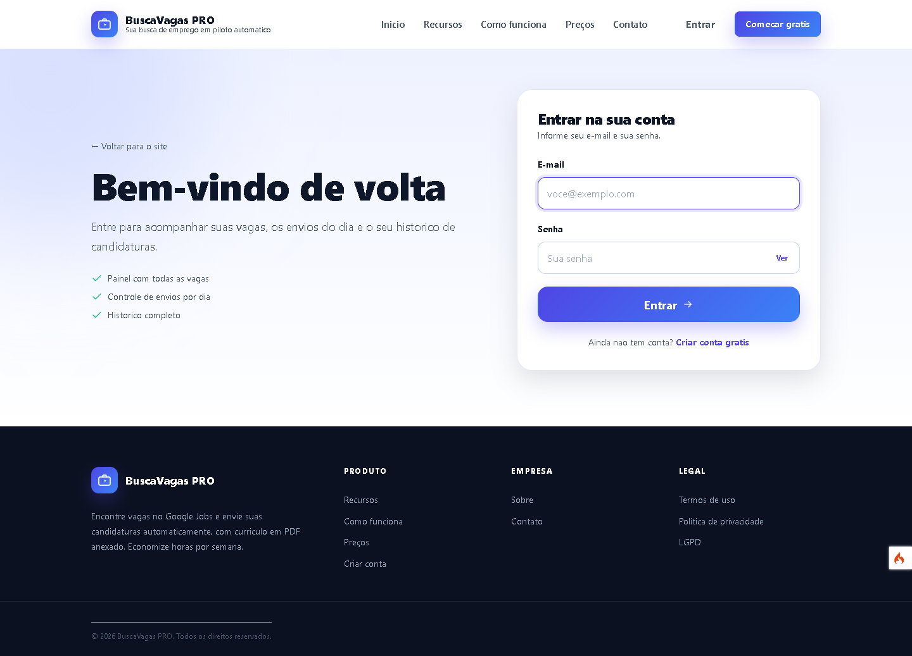

### Cadastro

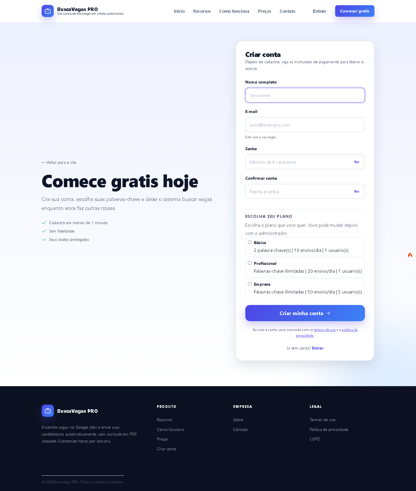

### Painel do usuário

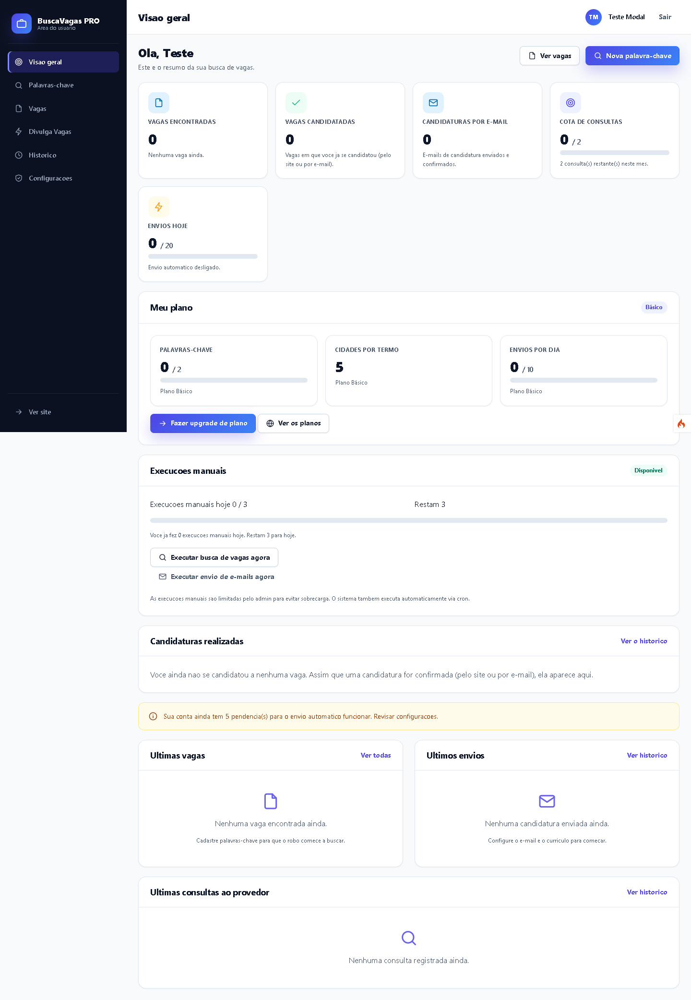

### Vagas encontradas

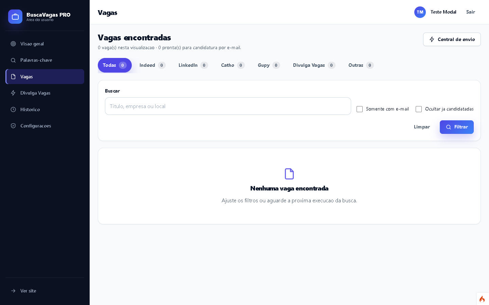

### Palavras-chave

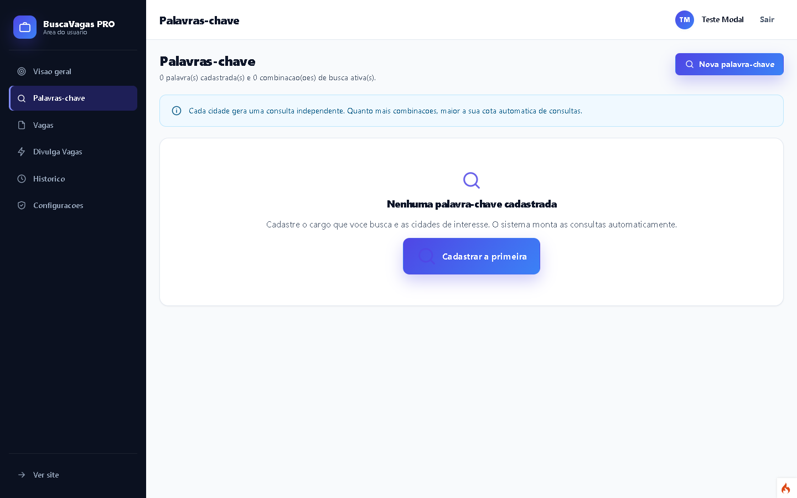

### Candidatura automática (Divulga Vagas)

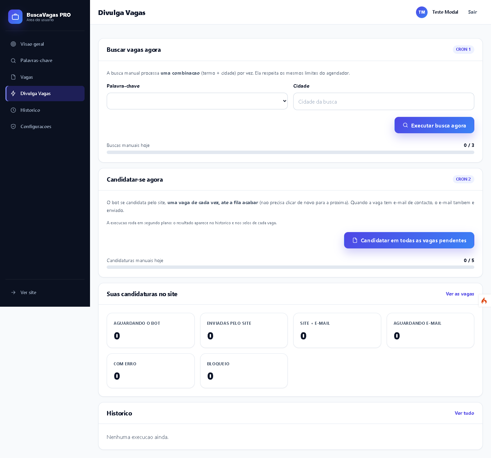

### Plano e upgrade

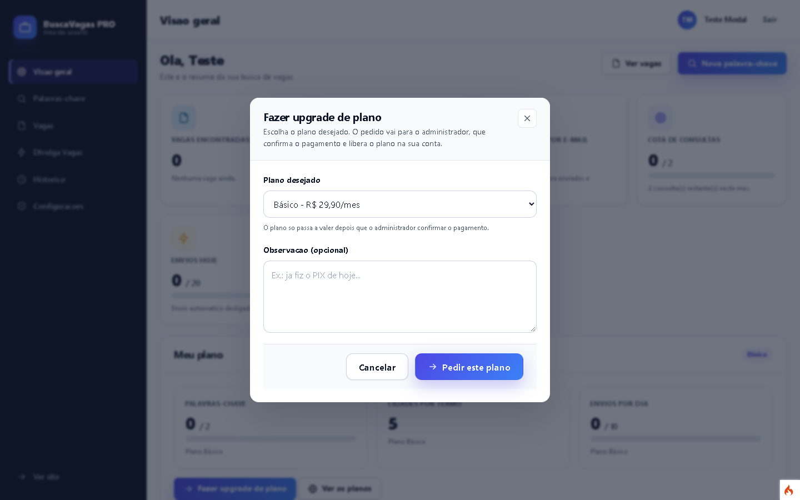

### Painel administrativo

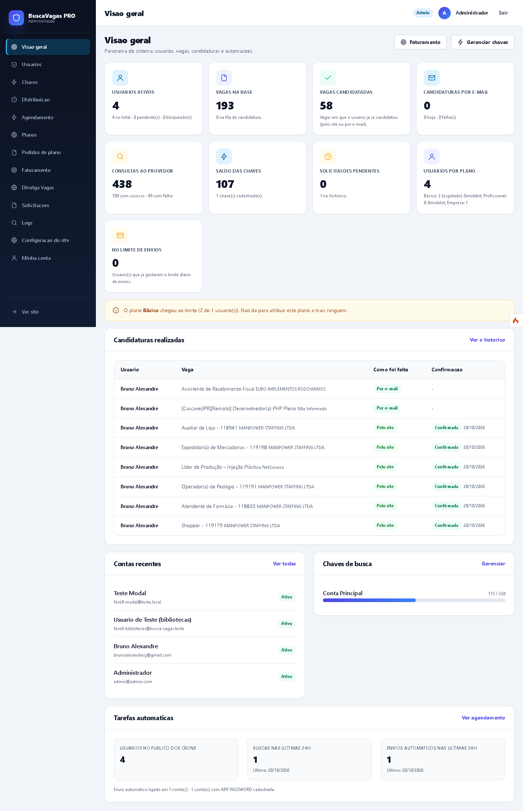

### Planos

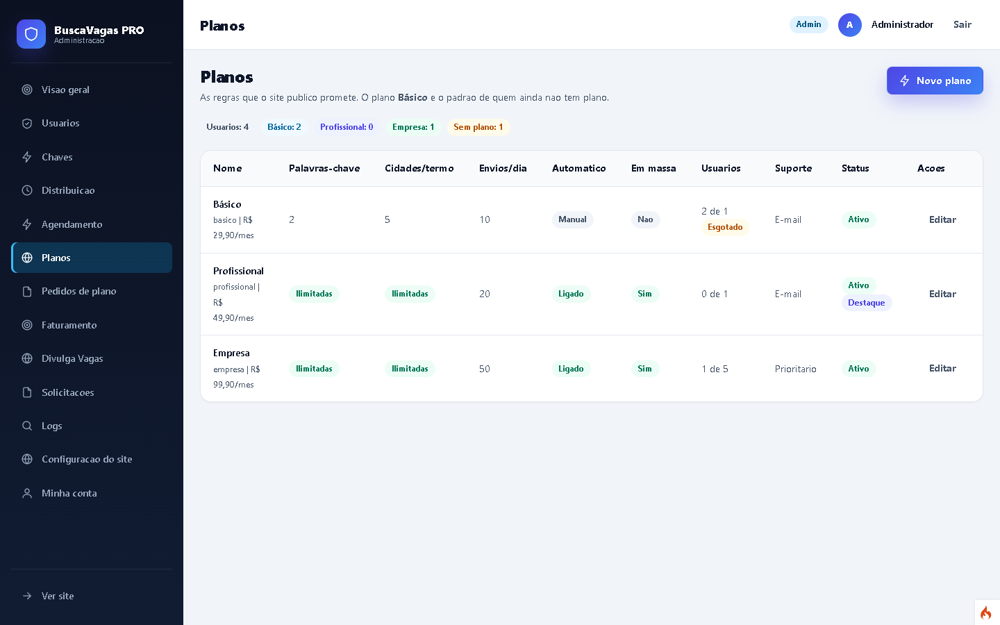

### Pedidos de plano

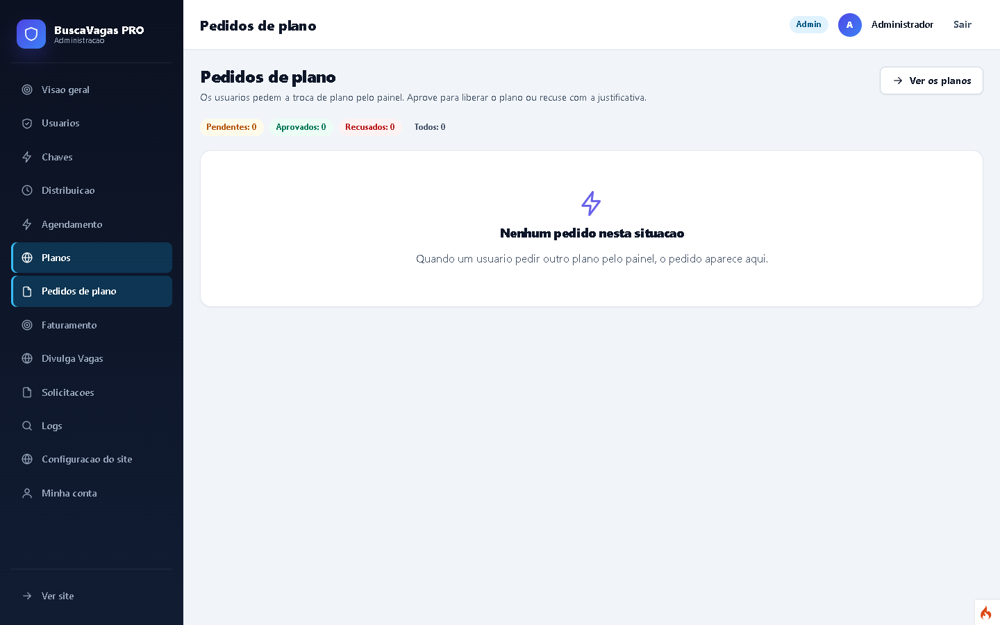

### Relatório de faturamento

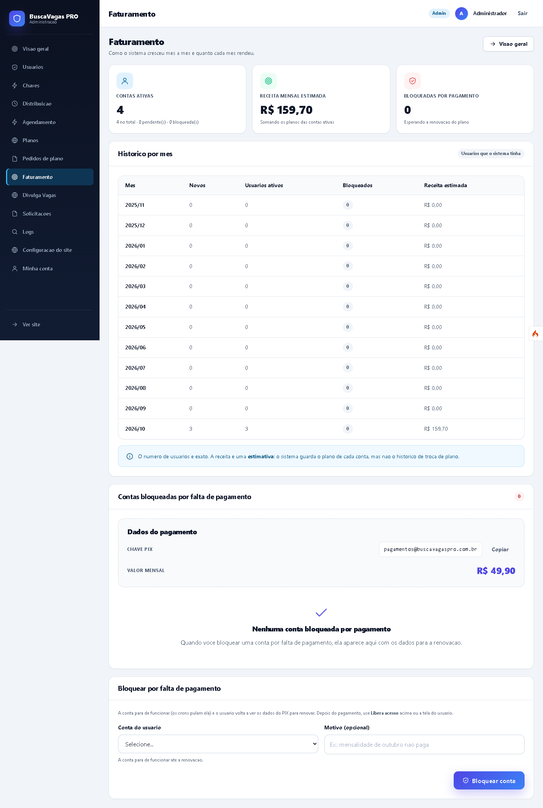

---

## Apoie este projeto

Este projeto é **open source** e roda no **servidor de quem usa**: o
código é seu e o servidor também. A doação é **voluntária** e **não
inclui hospedagem, suporte nem instalação**.

### Pix (doação)

```
bruno@brunoalexandre.com
```

### Precisa de ajuda para colocar no ar?

Também faço implantação de ponta a ponta e treinamento para quem quer
colocar o sistema em produção: preparar o servidor, banco de dados,
agendamento (cron), bot com navegador real e o treinamento de quem vai
usar no dia a dia.

- Contato: `bruno@brunoalexandre.com`
- Isso é um **serviço à parte**, com orçamento próprio.
- O Pix acima é **exclusivamente para doação**: ele não contrata, não
  garante e não substitui o serviço.

---

### Documentacao relacionada

- [docs/agendamento-linux.md](docs/agendamento-linux.md)
- [docs/agendamento-windows.md](docs/agendamento-windows.md)
- [docs/agendamento-manual.md](docs/agendamento-manual.md)
- [docs/tutorial-cron-job-org.md](docs/tutorial-cron-job-org.md)
- [docs/deploy-producao.md](docs/deploy-producao.md)
- [docs/checklist-final.md](docs/checklist-final.md)
- [docs/revisao-final.md](docs/revisao-final.md)
